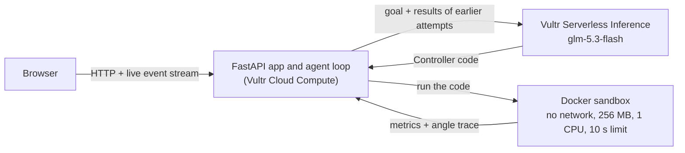

# Robot Control Tuner

**An AI agent that designs a motor controller, tests it in an isolated sandbox on Vultr, reads the measured results, and improves the design round by round until the motion is smooth.**

Built for the **Vultr Agent Rush hackathon** (lablab.ai), Challenge 1.

- **Live demo:** http://66.42.34.29:8000
- **Code:** https://github.com/Nidaamir083/robot-tuner
- **Team:** Nida Amir, Muhammad Daniyal Chishty, Muhammad Bilal Chishty


## The problem

A controller decides how hard a motor should push so a robot joint reaches its target without overshooting or shaking. Finding the right settings is called **tuning**, and engineers usually do it by hand: change a number, run a test, look at the graph, repeat.

## What this project does

1. The user states a goal: *move the joint from 0 to 90 degrees with overshoot under 8% and settling time under 1 second.*
2. The AI writes the control code.
3. A sandbox runs that code in a motor simulation and **measures** overshoot (how far it goes past the target), settling time (how long until it calms down) and final error.
4. The measurements go back to the AI, which writes an improved controller. The user watches every attempt as a graph.
5. The loop stops when the goal is met (or after 6 rounds). The final screen shows all attempts on one chart, the best one highlighted, and the best controller's code.

The AI **proposes** designs. The sandbox **measures** whether they work. Nothing is taken on the AI's word.

### Example run (live mode, real model)

| Attempt | Overshoot | Settling time | Final error | Goal met? |
|---|---|---|---|---|
| 1 | 2.45% | 3.18 s | 1.618° | No (too slow) |
| 2 | 4.86% | 2.70 s | 1.001° | No (too slow) |
| 3 | 0.57% | 0.68 s | 0° | **Yes** |

Results differ from run to run because the model is not deterministic. Some rounds can also fail (for example, an empty or malformed model reply). These are caught, shown on the page, and fed back to the model, so one bad round does not end the run.

---

## How Vultr powers the solution

Vultr is the center of the system: it hosts the app, runs the orchestration, runs the sandbox, and provides the AI model.

| Vultr service | What we use it for |
|---|---|
| **Vultr Cloud Compute** (Dedicated CPU, `vx1-g-2c-8g`, 2 vCPU / 8 GB, Tokyo, Ubuntu 24.04) | Runs the web app, the agent loop (orchestrator), and the Docker sandbox containers. |
| **Vultr Bootable Block Storage** (50 GB) | Boot volume of the instance. |
| **Vultr Serverless Inference** (OpenAI-compatible API at `https://api.vultrinference.com/v1`, model `glm-5.3-flash`) | The agent's LLM: it writes and improves the controller code on every round. |

Vultr GPUs are not used.

### Architecture



**Request flow**

1. The browser opens `/api/run`, and the server streams one event per attempt (Server-Sent Events), so graphs appear live.
2. `app/loop.py` asks the model (`app/llm.py`) for a `Controller` class. From round 2 on, the prompt includes the last attempts with their measured results or errors.
3. `app/sandbox.py` writes the code to a temporary folder and starts a throwaway Docker container that runs `sandbox/runner.py`.
4. The runner simulates the motor, computes the metrics and prints JSON. The container is removed afterwards.
5. The loop scores the attempt, streams it to the browser, and either stops (goal met) or asks the model for the next version.

### The use case: real tasks, really executed

The agent does not just describe a controller. It writes real Python code, that code really runs in a simulation, and the real measurements decide what happens next. This is the same trial-and-error loop an engineer follows when tuning, automated.

---

## Containment: running AI-written code safely

The model's code is untrusted, so it never runs in the app process. Every candidate runs in a separate Docker container with:

| Protection | Setting |
|---|---|
| No network | `--network none` |
| Memory limit | `--memory 256m` |
| CPU limit | `--cpus 1` |
| Process limit | `--pids-limit 64` |
| Read-only filesystem | `--read-only`, code mounted read-only |
| No extra privileges | `--cap-drop ALL`, `--security-opt no-new-privileges`, non-root user |
| Time limit | 10 seconds, then the container is killed with `docker kill` |

**Containment moment.** If the AI's code contains an endless loop, the sandbox stops it at the time limit and the page shows **"Run stopped safely"**. A live model rarely writes an endless loop on demand, so the page has a **Run safety test** button. It sends a deliberately broken controller (an endless loop, written by us and labelled as such on screen) into the same sandbox so the behavior can be shown at any time. Crashes in the AI's code (for example a division by zero) are caught in the same way and reported back to the model.

---

## The simulation and the scoring

- **Plant:** a DC motor driving a joint, `J·θ'' = K·u − b·θ'`, with J = 0.02, b = 0.1, K = 0.5. The voltage is limited to ±12 V. The simulation runs 4 seconds at 1 ms steps.
- **Controller interface:** `class Controller` with `update(self, target, angle, velocity, dt)` returning a voltage.
- **Metrics:** overshoot (%), settling time (first time after which the angle stays within 2% of the target), and final error (degrees).
- **Goal:** overshoot ≤ 8%, settling time ≤ 1 s, final error < 0.5°. The loop runs at most 6 rounds.
- **Score** (lower is better, used to pick the best attempt): overshoot + 20 × settling time + 10 × final error. A run that fails or never settles scores worst.

---

## Run it yourself

Requirements: Linux with Docker, Python 3.12, and a Vultr Serverless Inference API key.

```bash
git clone https://github.com/Nidaamir083/robot-tuner.git
cd robot-tuner

# build the sandbox image
docker build -t robot-sandbox sandbox/

# python environment
python3 -m venv .venv
.venv/bin/pip install fastapi uvicorn openai

# settings (never commit this file)
cat > .env <<'EOF'
LLM_API_KEY=your-vultr-inference-key
LLM_BASE_URL=https://api.vultrinference.com/v1
LLM_MODEL=glm-5.3-flash
EOF

# start the app, then open http://<server-ip>:8000
.venv/bin/uvicorn app.main:app --host 0.0.0.0 --port 8000
```

Useful checks:

```bash
python3 test_sandbox.py        # good, weak, endless-loop and crashing controllers
python3 run_loop.py            # run the full agent loop in the terminal
```

**Demo mode.** If no API key is set (or `MOCK_LLM=1`), the app plays a scripted sequence of controllers so the loop and the safety stop can be tested without the model. The page then shows **"Demo mode (scripted, no AI)"**. In live mode it shows **"Live AI"** and the model name.

### How it is deployed on Vultr

- Instance: Vultr Cloud Compute, Tokyo, Ubuntu 24.04, SSH-key login with a limited user.
- Firewall: only ports 22 (SSH) and 8000 (app) are open.
- The app runs as a `systemd` service (`robot-tuner`) with automatic restart, so it keeps running when no one is logged in and comes back after a reboot.

---

## Project structure

```
robot-tuner/
├── app/
│   ├── main.py        # FastAPI app: page, live run stream, safety test
│   ├── loop.py        # the agent loop, scoring and goal check
│   ├── llm.py         # prompts, model call, code extraction, demo mode
│   └── sandbox.py     # starts the Docker container with all limits
├── sandbox/
│   ├── Dockerfile     # minimal Python image, non-root user
│   └── runner.py      # motor simulation and metrics (runs inside the container)
├── static/
│   └── index.html     # the web page with live graphs
├── test_sandbox.py
└── run_loop.py
```

---

## Business value

Tuning controllers by hand is slow, repetitive engineering work that appears in robotics, factory automation, drones and motion systems. An agent that proposes a design, tests it, and learns from the measurements can cut the number of manual trial-and-error cycles and shorten commissioning time. The sandbox is what makes this practical: engineers can let an AI write code without trusting it.

## Limitations and next steps

- The motor is a simplified linear model. A real deployment needs a model of the actual hardware (friction, noise, load changes), and the model's explanations in its code comments are its own guesses, not verified findings.
- Docker isolation is a strong start but not a perfect security boundary. Stronger isolation such as gVisor would be a sensible next step.
- The demo is served over plain HTTP, has no login, and allows one run at a time to protect the server and the model quota.
- Possible extensions: other plants (robot arm with several joints), disturbances and noise, comparing several models, and using throwaway Vultr instances for larger parallel test runs.